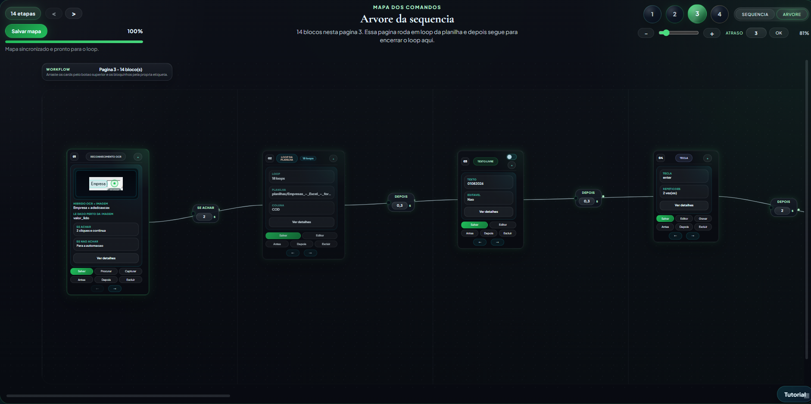
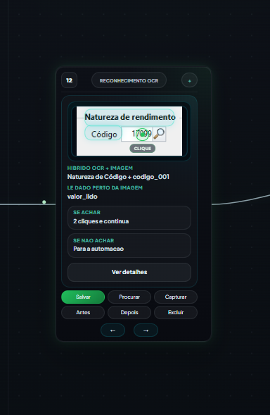
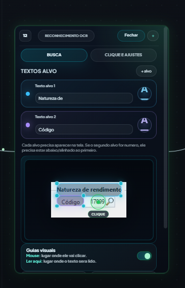
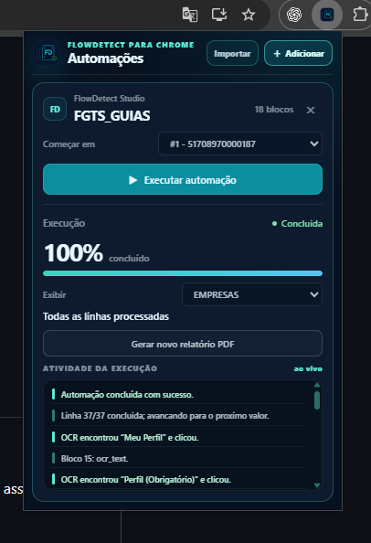

<div align="center">


# FlowDetect
**AUTOMAÇÃO VISUAL · DESKTOP & WEB · STUDIO + AGENT + CHROME**

Crie, teste e execute automações em blocos em sistemas Windows e páginas web — mesmo sem API.

[**⬇️ Baixar última versão**](https://github.com/kaua-ananiass/FlowDetect/releases/latest) · [**Todas as releases**](https://github.com/kaua-ananiass/FlowDetect/releases) · [**Recursos**](#recursos-em-destaque) · [**Galeria**](#galeria)

   
</div>

---

## Visão geral
O **FlowDetect** transforma tarefas repetitivas em fluxos visuais reutilizáveis. Combina **teclado, mouse, OCR, reconhecimento por imagem, planilhas, interação com o navegador e decisões condicionais** para automatizar rotinas em ERPs, portais web, sistemas administrativos e aplicações desktop.

## Um ecossistema, três componentes
<table><tr><td width="33%" valign="top"><h3>🧩 FlowDetect Studio</h3><p><b>Crie e acompanhe.</b> Editor visual de blocos, sequências, loops, gravador inteligente e testes assistidos.</p></td><td width="33%" valign="top"><h3>🖥️ FlowDetect Agent</h3><p><b>Execute remotamente.</b> Agente Windows para receber automações e enviar andamento ao Studio.</p></td><td width="33%" valign="top"><h3>🌐 FlowDetect para Chrome</h3><p><b>Automatize páginas web.</b> Extensão com pareamento por código, reconhecimento de elementos e execução na aba do navegador.</p></td></tr></table>

## Recursos em destaque
| Criação e controle | Reconhecimento e dados | Execução e resultados |
|---|---|---|
| Editor visual em blocos | OCR e reconhecimento por imagem | Testes assistidos |
| Loops, rotas e condições | Captura de elementos no Chrome | Execução via Agent remoto |
| Gravador inteligente | Leitura e escrita em planilhas | Relatórios PDF e exportação |
| Janela alvo | Tratamento de downloads | Acompanhamento de progresso |

## Galeria
> Imagens oficiais de releases anteriores. A interface atual pode apresentar alterações.

### Mapa visual de automações
<p align="center"></p>

### Reconhecimento visual e OCR
<p align="center"> </p>

### Extensão do Chrome
<p align="center"></p>

## Downloads
**As releases oficiais estão neste repositório.**

| Componente | Plataforma | Onde baixar |
|---|---|---|
| **FlowDetect Studio** — instalador NSIS | Windows | [Última release](https://github.com/kaua-ananiass/FlowDetect/releases/latest) |
| **FlowDetect Agent** — instalador | Windows | [Última release](https://github.com/kaua-ananiass/FlowDetect/releases/latest) |
| **FlowDetect para Chrome** — pacote ZIP | Chrome | [Última release](https://github.com/kaua-ananiass/FlowDetect/releases/latest) |
| **Studio DMG experimental** | Mac com Apple Silicon | [Artefatos do GitHub Actions](https://github.com/kaua-ananiass/FlowDetect/actions/workflows/macos-arm64-dmg.yml) |

> O DMG de macOS ainda é experimental: a instalação e funcionalidades precisam ser testadas em Mac real, e assinatura/notarização estão pendentes.

## Como funciona
1. **Monte** a automação no Studio, com blocos de ação, verificação, planilha e condição.
2. **Teste** os blocos e o fluxo com acompanhamento visual.
3. **Execute** no ambiente adequado: Windows, Agent remoto ou Chrome.
4. **Acompanhe** os resultados, caminhos de falha e relatórios.

## Tecnologias
**Tauri · Rust · Python · JavaScript · HTML/CSS · OpenCV · OCR · OpenPyXL · Playwright**

## Para desenvolvedores
<details><summary><b>Estrutura do código, preparação do ambiente e referências técnicas</b></summary>

| Pasta | Conteúdo |
|---|---|
| `tauri_gerador/` | Studio e backend Tauri |
| `flowdetect_agent/` | Aplicativo do Agent |
| `flowdetect_chrome/` | Extensão Chrome |
| `flowdetect_runner/` | Runner desktop |
| `scripts/` | Compilação e ferramentas |
| `docs/` | Documentação |
| `tests/` | Testes automatizados |

**Desenvolvimento do Studio (Windows):**
```powershell
cd tauri_gerador
npm.cmd install
npm.cmd run tauri:dev
```
**Dependências Python:**
```powershell
python -m pip install -r requirements.txt
python -m playwright install
```
**Compilação Windows:**
```powershell
powershell -ExecutionPolicy Bypass -File .\scripts\compilar_gerador_exe.ps1
```
[Compilação](docs/COMPILACAO.md) · [Agent](docs/README_AGENTE.md) · [Hyper-V](docs/HYPERV_AGENTES.md)
</details>

---

<div align="center"><strong>FlowDetect</strong> — do mapa visual à execução acompanhada.<p><a href="https://github.com/kaua-ananiass/FlowDetect/releases/latest">Baixar versão estável</a> · <a href="https://github.com/kaua-ananiass/FlowDetect/releases">Histórico de versões</a></p></div>

<details><summary><b>Documentação técnica detalhada e recursos anteriores</b></summary>

## Referência técnica: blocos disponíveis

- **Texto livre:** digita textos fixos ou dinamicos.
- **Tecla/Atalho:** executa teclas, atalhos e repeticoes.
- **Reconhecimento visual:** procura uma imagem na tela e decide o fluxo.
- **Planilha:** usa uma coluna como loop de execucao.
- **Escrever celula:** grava status, observacoes ou resultados na linha atual da planilha.
- **Resultado do relatorio:** define o status, a mensagem e a evidencia da linha atual no PDF final do loop.
- **Inicio/Fim do loop:** delimita trechos repetidos por linha da planilha.
- **Verificar estado:** valida imagens/estados antes de continuar.
- **Abrir URL:** abre sites no navegador escolhido.
- **Abrir Programa:** inicia executaveis antes da automacao principal.
- **Salvar download:** monitora uma pasta, encontra o arquivo baixado e move para o destino escolhido.

## Recursos Recentes

- **Capturar fluxo:** fotografa o mapa original, mantendo cards, botões, posições, marcadores OCR e curvas das conexões. Inclui blocos fora da tela e salva em PNG de alta resolução (3×, com limite de memória para fluxos grandes). Captura a página atual por padrão; também pode incluir todas as páginas. O SVG opcional deve ser aberto no Chrome ou Edge.
- **Mapa mais fluido:** criacao, exclusao e movimentacao de blocos com animacoes suaves.
- **Cards compactos e detalhados:** o bloco mostra o essencial no mapa e abre detalhes quando necessario.
- **Gravador Inteligente:** cria blocos automaticamente a partir de cliques, textos e teclas gravadas.
- **OCR por elemento:** pode capturar e validar um elemento da pagina como fonte de reconhecimento.
- **Extensão Chrome:** exporta automações web para executar diretamente na aba atual do navegador.
- **Planilha em tempo real:** permite usar linhas como loop e atualizar celulas durante a execucao.
- **Relatorio PDF compacto:** ao finalizar um loop de planilha, gera um resumo visual com cada linha, resultado, horario e status configurado no fluxo.
- **Agent remoto:** o Studio pode enviar automacoes para outro PC, iniciar execucoes e acompanhar o andamento.
- **Tela remota:** visualizacao da tela do Agent dentro do Studio para acompanhar a automacao.

## Utilidade

O FlowDetect ajuda a transformar processos manuais repetitivos em fluxos visuais reutilizaveis.

Exemplos de uso:

- preenchimento de sistemas com dados de planilha;
- rotinas fiscais e administrativas;
- navegacao em portais sem API;
- cliques condicionais por reconhecimento de imagem;
- organizacao automatica de arquivos baixados;
- registro de status diretamente em planilhas;
- execucao de varias empresas, clientes ou codigos em sequencia.

## Tecnologias

- Python
- Tauri
- HTML/CSS/JavaScript
- PyAutoGUI
- OpenCV
- OpenPyXL
- Playwright

## Organizacao do projeto

| Pasta | Conteudo |
| --- | --- |
| `tauri_gerador/` | Interface e backend do Studio. |
| `flowdetect_agent/` | Aplicativo do Agent. |
| `flowdetect_chrome/` | Codigo-fonte da extensao Chrome. |
| `flowdetect_runner/` | Runner desktop. |
| `scripts/` | Compilacao, limpeza e launchers usados no empacotamento. |
| `docs/` | Guias de compilacao, Agent e Hyper-V. |
| `tests/` | Testes automatizados. |

Os arquivos Python da raiz sao o runtime compartilhado pelos aplicativos. Os dados de automacoes, planilhas e imagens ficam nas pastas proprias. Consulte os guias de [compilacao](docs/COMPILACAO.md), [Agent](docs/README_AGENTE.md) e [Hyper-V](docs/HYPERV_AGENTES.md).

## Rodar em Desenvolvimento

```powershell
cd tauri_gerador
npm.cmd run tauri:dev
```

## Instalar Dependencias Python

```powershell
python -m pip install -r requirements.txt
python -m playwright install
```

## Compilar

```powershell
powershell -ExecutionPolicy Bypass -File .\scripts\compilar_gerador_exe.ps1
```

## Extensão para Chrome

A primeira versão da extensão fica em `flowdetect_chrome/`.

1. No Chrome, abra `chrome://extensions` e ative o **Modo do desenvolvedor**.
2. Clique em **Carregar sem compactação** e selecione `flowdetect_chrome`.
3. Para conectar diretamente, abra a extensão e copie o código de seis dígitos exibido no topo.
4. No Launcher do Studio, clique em **Conectar Chrome**, digite o código e aguarde **Conectado ao Studio**. O pareamento é lembrado nos próximos reinícios.
5. Na Biblioteca, use **Enviar à extensão** para importar uma nova cópia sem arquivo intermediário. A opção **Exportar para Chrome** continua disponível para gerar um JSON e importá-lo manualmente.

O Studio e o Chrome precisam estar no mesmo computador. Se a extensão mostrar **Studio não encontrado**, confirme que o Studio atualizado está aberto; o código não substitui a comunicação local. Para testar OCR no Chrome, abra a página HTTP/HTTPS desejada e escolha **No Chrome** no teste do bloco.

Para ajustar um OCR ao iniciar uma automação, marque **Editável na extensão** no texto alvo do bloco, salve o mapa e envie/exporte novamente. A extensão mostrará **Textos OCR editáveis** no card da automação. A troca altera só a validação daquela execução; o clique e as rotas permanecem os mesmos.

Para retirar empresas antes de rodar um loop de planilha, abra **Empresas do loop** no card da extensão. Busque pelo nome ou CNPJ e desmarque as linhas a ignorar; a contagem de empresas ativas e a opção **Começar em** se ajustam automaticamente. A extensão pede confirmação antes de executar com exclusões. Por padrão, a seleção vale só para a execução atual; marque **Salvar exclusões nesta automação** para reutilizá-la depois. O arquivo original e o mapa não são alterados. O PDF final lista as linhas ignoradas separadamente das processadas.

Ela executa URL, texto, teclas, loops de planilha, OCR de texto ou elemento da página e reconhecimento visual por imagem. As referências visuais são incluídas no JSON exportado para a extensão funcionar sem depender da pasta de imagens do Studio.

## Observacao

Automacoes desktop dependem da tela real do computador. Para melhor estabilidade, use janela alvo, imagens bem recortadas e tempos de espera adequados ao sistema automatizado.


</details>
