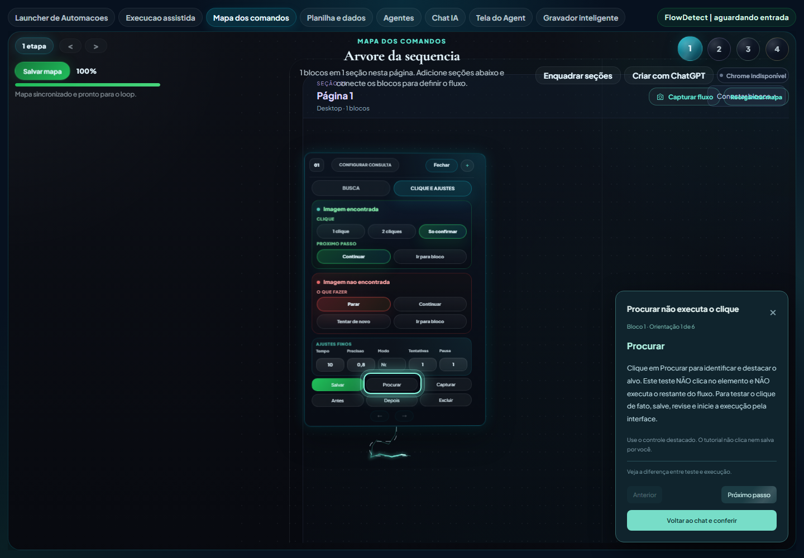

# Atualização de 11/11/2026: criação guiada, tabelas e Agent

Esta branch reúne as alterações de produto acumuladas depois do merge do PR #48 na `main` (`383f629`). O foco é construir automações com orientação dentro do Studio, mantendo OCR, tabelas do Chrome e controle do Agent compatíveis com o fluxo atual.

Studio e Agent mantêm a identificação **3.1.1**; o código da extensão está em **0.2.95**. A publicação desta branch não cria uma release nem um instalador novo.

## Chat IA e criação guiada

- Login oficial com ChatGPT no navegador, seleção de modelo, consulta de uso e desconexão. Credenciais permanecem no backend Windows, protegidas por DPAPI.
- Interface ampla, com menos molduras, respostas formatadas, animações de atividade e recebimento incremental do texto no modo Conversar.
- Histórico local com conversas independentes, busca, renomeação, exclusão e desfazer. Cada conversa preserva rascunho, modo, contexto, plano e proposta.
- Vínculo com a automação: retomar outro trabalho exige abrir o mapa associado antes de gerar ou aplicar configurações.
- **Criar fluxo** pergunta o que falta, mostra etapas editáveis e cria blocos reais em uma seção separada. **Gerar proposta** mantém a montagem direta de um conjunto revisável.
- Textos, URLs e teclas podem ser editados e salvos no chat. OCR e tabelas abrem os editores completos do mapa.
- Revisões do mapa e identidades estáveis impedem aplicar um plano desatualizado, abrir um bloco removido ou misturar respostas entre conversas.
- Carregamento explícito dos módulos locais para funcionar também no Python embutido e isolado do Studio.

## Conhecimento dos blocos e tutorial visual

O catálogo local documenta 17 tipos de bloco e 20 alvos de interface. A IA recebe campos, comportamentos e identificadores; os seletores permanecem no código local.

- O tutorial abre a aba interna necessária e envolve o controle real com um halo animado.
- Anterior/Próximo organiza a explicação em pequenos passos. O destaque acompanha rolagem, redimensionamento e alterações do editor.
- Controles ausentes naquele modo são informados, sem destacar outro botão por aproximação.
- **Procurar/Testar só identifica e destaca**. O clique ocorre durante a execução, conforme 1 clique, 2 cliques ou Só confirmar. **Salvar apenas grava**.
- A orientação não aciona captura, testes, alterações de campos ou salvamento por conta própria.



## OCR e variáveis

- Região da variável posicionada e redimensionada sobre a referência visual.
- Teste conjunto de OCR e variável, reaproveitando a âncora confirmada.
- Retorno do texto/valor encontrado e destaque amarelo para a variável.
- Biblioteca de variáveis no bloco de texto e reutilização por `{{VARIAVEL}}`.
- Compatibilidade entre execução desktop e Chrome, com limpeza de valores entre iterações.

## Tabelas do Chrome

- Mapeamento por estrutura e botões, sem fixar números de guias ou valores de uma empresa.
- Leitura das páginas da tabela e percurso linha a linha: abrir detalhe, capturar a tabela interna e retornar à lista.
- Identificação de colunas, botões e controles de retorno; prévia didática da estrutura.
- Acúmulo dos resultados e geração de planilha com dados da lista e do detalhamento.
- Diagnóstico da etapa, guia atual, falhas de captura e retorno, em vez de apresentar somente “Falhou”.
- O transporte de chamadas de mapa desktop/Chrome permanece separado da antiga interface de Encadeamentos, removida nesta atualização.

## Agent e compatibilidade

- Captura nativa do monitor principal com DXGI Desktop Duplication e transporte WebRTC. O visualizador não usa a transmissão alternativa de quadros JPEG.
- Acesso não assistido por senha, revogação e persistência da preferência de mouse/teclado.
- Tratamento de entrada remota no Windows, estatísticas de vídeo e alinhamento das dependências compartilhadas entre Studio, Agent e Runner.
- Resolução e fluidez dependem de rede, WebView2, GPU e drivers; o perfil configurado não é uma garantia de FPS observado.

## Limpeza da interface

Saem o catálogo de integrações planejadas, a aba Alterdata e a interface/rotas dedicadas de Encadeamentos. Automações pessoais existentes não fazem parte dos arquivos publicados nesta branch.

## Organização dos dez commits

1. Refinamento do teste visual de variáveis OCR.
2. Estruturas, percursos e resultados de tabelas no Chrome.
3. Vídeo nativo e entrada remota do Agent.
4. Ponte de execução do mapa e caminhos editáveis.
5. Componentes React/TypeScript, estilos e animações do chat.
6. Autenticação ChatGPT e histórico local protegido.
7. Validação e construção guiada de blocos reais.
8. Interface do chat, conversas e edição dos cartões.
9. Catálogo de blocos e tutorial com halo.
10. Integração no Studio, empacotamento, remoção dos recursos antigos e documentação.

Os módulos preparatórios entram nos primeiros commits; a conexão completa com os pontos de entrada do Studio é concluída no último.

## Validação e limites

As verificações incluem TypeScript, bundle React/Tailwind, testes Python dos planos e do runtime embutido, testes de navegador para histórico/isolamento/edição e abertura do editor real com halo, além da conferência dos recursos de empacotamento.

```powershell
python -m unittest discover -s tests -p test_chatgpt_guided.py -v
python -m unittest discover -s tests -p test_chatgpt_flow.py -v
python -m unittest discover -s tests -p test_runtime_package_layout.py -v
node --test tests/test_chatgpt_browser.cjs tests/test_studio_workspace_cleanup.cjs
cd tauri_gerador
npm ci
npm run chat:check
npm run chat:build
```

Os testes de interface simulam as respostas do modelo. Não foi feita uma nova solicitação de inferência real para publicar a branch. A validação de um portal autenticado, entre empresas e no computador remoto continua dependendo do ambiente do usuário.

O chat não vê prints, linhas de planilhas ou resultados de execução automaticamente; o plano editado e as configurações necessárias acompanham a conversa. O usuário captura as referências e inicia a execução. Configurado não equivale a testado.

Veja também: [guia do chat](CHATGPT_STUDIO.md), [componentes e arquitetura](CHATGPT_COMPONENTES.md), [variáveis OCR](VARIAVEIS_OCR.md), [tabelas Chrome](TABELAS_CHROME.md) e [vídeo do Agent](VIDEO_AGENTE.md).
